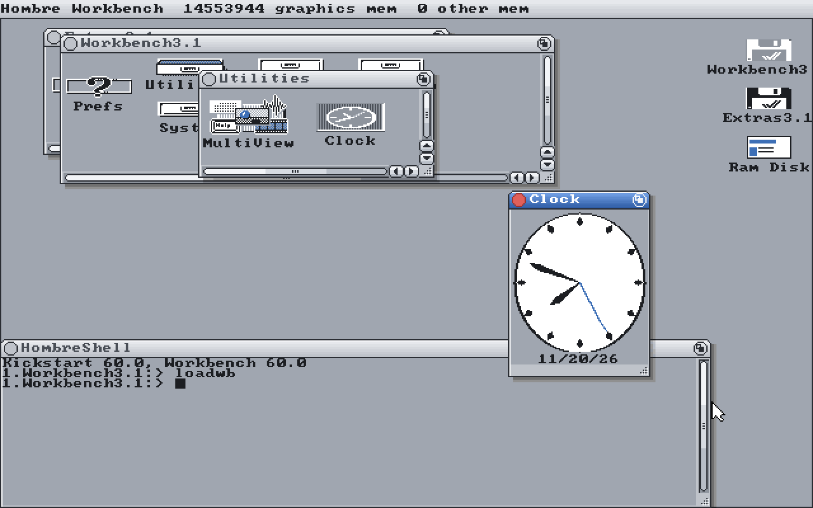

<p align="center">
  
</p>

Hombre is an operating system for x86-64 PCs that is compatible with AmigaOS
and MorphOS. It aims to run classic Amiga 680x0 applications alongside native
software, on modern hardware and in virtual machines.



## Features

- Runs unmodified Amiga 68000 programs through a built-in 68k to x86-64
  translator.
- Native AmigaOS libraries written in C++: exec, dos, intuition, graphics,
  layers, gadtools, icon, workbench, utility, keymap and version, with
  timer.device, console.device, audio.device and scsi.device, and
  cybergraphics.library for programs written for graphics cards. No
  Kickstart ROM needed.
- Reads real Amiga floppy images, ADF and DMS, in DF0: to DF3:, next to a
  writable Ram Disk.
- Hard disks: RDB-partitioned hard disk images (HDF), and Amiga partitions
  inside an MBR or GPT disk, on virtio, SATA (AHCI) and NVMe. The
  partitions mount as DH0: and on, can be written, and Hombre boots from
  the bootable one with the highest boot priority, as an Amiga does.
- HDToolBox from the 3.1 Install disk sees the disks through scsi.device.
- Boots with a splash and a progress bar, then runs the boot disk's
  `S:Startup-Sequence`, as an Amiga does.
- A Workbench desktop: drawers, framed icons as on 3.1, icon drag and drop,
  snapshot, sliders and scroll arrows, menus, backdrop on and off.
- The Workbench file operations: new drawers, copy, rename, delete, leave
  out and empty the Trashcan, an Information window for protection bits,
  comments, stack and tool types, and Execute Command.
- Preferences from the 3.1 Extras disk: Palette recolours the whole system,
  WBPattern gives the Workbench a backdrop pattern or picture, Font sets the
  system fonts, Pointer the mouse pointer, Input the double-click time, and
  ScreenMode reopens the Workbench in another mode.
- Every standard PAL and NTSC screen mode, Low, High and Super-High Res,
  plain and laced, in up to 256 colours, scaled to fill the display.
- HOMBRE screen modes: PC and widescreen sizes from 800x600 to 3840x2160,
  720p, 1080p and 1440p among them, in 256 colours, 16-bit and 24-bit, with
  square pixels, the depth picked by ScreenMode's Colors slider. The Workbench runs in them through ScreenMode prefs, and
  CyberGraphX programs draw on them. In QEMU and VirtualBox the display
  switches to each mode's size; elsewhere a mode of the display's own
  size is shown pixel for pixel.
- Built-in topaz and Hasklig fonts, Hasklig antialiased on 256-colour
  screens.
- HombreShell, a native shell with the Workbench 3.1 builtins that runs the
  3.1 `C:` commands and AmigaDOS scripts.
- Starts programs such as Clock and Calculator from the AmigaOS 3.1 disks.
- A modern window look: shaded title bars, knob-style buttons with the 3.1
  symbols and soft shadows, in the colours of your palette.
- A 64-bit kernel with UEFI boot, preemptive multitasking, and USB keyboard
  and mouse.

## Documentation

The wiki has the full story:

- **[Feature tour](https://github.com/adeptum-labs/hombre/wiki/Feature-Tour)**:
  the Workbench, Amiga programs, Preferences, the shell and disks, with
  screenshots.
- **[Getting started](https://github.com/adeptum-labs/hombre/wiki/Getting-Started)**:
  requirements, building, and booting your Workbench disks.
- **[How it works](https://github.com/adeptum-labs/hombre/wiki/How-It-Works)**:
  the design, explained with diagrams.
- **[Compatibility and status](https://github.com/adeptum-labs/hombre/wiki/Compatibility-and-Status)**:
  what runs today and what comes next.
- **[Supported hardware](https://github.com/adeptum-labs/hombre/wiki/Supported-Hardware)**:
  the processor, firmware, display, input and disks Hombre needs.
- **[HombreShell](https://github.com/adeptum-labs/hombre/wiki/HombreShell)**:
  builtins, commands and keys.
- **[Developer notes](https://github.com/adeptum-labs/hombre/wiki/Developer-Notes)**:
  make targets, tests, boot checks and the probe script.

## Quick start

Requirements:

- clang 14 or newer, g++ 12 or newer and GNU make
- GNU binutils with the i386pep target, and `binutils-m68k-linux-gnu`
- mtools and sgdisk
- QEMU with KVM, and OVMF installed at `/usr/share/OVMF`

Build and boot a Workbench disk:

```sh
make
make run DISK="path/to/Workbench.dms"
```

`DISK=` is the floppy in DF0:, a DMS archive or a raw ADF image. `DISK1=`,
`DISK2=` and `DISK3=` put disks in DF1: to DF3:. Without `DISK=`, Hombre
boots a generated test disk.

Hombre ships no AmigaOS files. Use your own, legally owned AmigaOS disks.

Add a hard disk image with `HDF=`. `mkhdf` makes one, here a 128 MB disk
whose bootable DH0: holds a copy of the floppy:

```sh
make build/tools/mkhdf
build/tools/mkhdf --size 128 dh0.hdf "path/to/Workbench.dms"
make run HDF=dh0.hdf
```

`mkhdf --size 128 --empty FFS Work work.hdf` makes an empty FFS disk
instead. `HDF1=` to `HDF3=` add more disks, and `HDF_BUS=ahci` or
`HDF_BUS=nvme` puts them on a SATA or NVMe controller. Hombre writes to
the image, so a file you save is there after the next boot.

Hombre runs the disk's `S:Startup-Sequence`. On the Workbench 3.1 disk it
ends with `LoadWB`, so you land on the Workbench. Press Ctrl+D while Hombre
boots to stop the script and get the shell prompt instead.

`make test` runs the host unit tests and `make check` runs the headless
boot checks. See the
[Developer notes](https://github.com/adeptum-labs/hombre/wiki/Developer-Notes).
