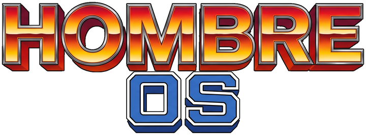

<p align="center">
  
</p>

Hombre is an operating system for x86-64 PCs that is compatible with AmigaOS
and MorphOS. It aims to run classic Amiga 680x0 applications alongside native
software, on modern hardware and in virtual machines.


## Features

- Runs unmodified Amiga 68000 programs through a built-in 68k to x86-64
  translator.
- Native AmigaOS libraries and devices written in C++. No Kickstart ROM
  needed.
- A Workbench desktop with file operations and the 3.1 Preferences editors.
- HombreShell, which runs the 3.1 `C:` commands and AmigaDOS scripts.
- ADF and DMS floppy images, and writable Amiga hard disk partitions on
  virtio, SATA and NVMe.
- PAL, NTSC and widescreen modes up to 3840x2160, in 8, 16 and 24-bit.
- A system monitor on F12 to stop a hung program or swap floppies.
- A 64-bit kernel with UEFI boot and preemptive multitasking.

## Documentation

The wiki has the full story:

- **[Feature tour](https://github.com/adeptum-labs/hombre/wiki/Feature-Tour)**:
  the Workbench, Amiga programs, Preferences, the shell and disks, with
  screenshots.
- **[Getting started](https://github.com/adeptum-labs/hombre/wiki/Getting-Started)**:
  requirements, building, and booting your Workbench disks.
- **[How it works](https://github.com/adeptum-labs/hombre/wiki/How-It-Works)**:
  the design, explained with diagrams.
- **[Compatibility and status](https://github.com/adeptum-labs/hombre/wiki/Compatibility-and-Status)**:
  what runs today and what comes next.
- **[Supported hardware](https://github.com/adeptum-labs/hombre/wiki/Supported-Hardware)**:
  the processor, firmware, display, input and disks Hombre needs.
- **[System monitor](https://github.com/adeptum-labs/hombre/wiki/System-Monitor)**:
  what F12 shows and does, with screenshots.
- **[HombreShell](https://github.com/adeptum-labs/hombre/wiki/HombreShell)**:
  builtins, commands and keys.
- **[Developer notes](https://github.com/adeptum-labs/hombre/wiki/Developer-Notes)**:
  make targets, tests, boot checks and the probe script.

## Quick start

Requirements:

- clang 14 or newer, g++ 12 or newer and GNU make
- GNU binutils with the i386pep target, and `binutils-m68k-linux-gnu`
- mtools and sgdisk
- QEMU with KVM, and OVMF installed at `/usr/share/OVMF`

Build and boot a Workbench disk:

```sh
make
make run DISK="path/to/Workbench.dms"
```

`DISK=` is the floppy in DF0:, a DMS archive or a raw ADF image. `DISK1=`,
`DISK2=` and `DISK3=` put disks in DF1: to DF3:. Without `DISK=`, Hombre
boots a generated test disk. The machine has four processors; `SMP=`
sets another number.

Hombre ships no AmigaOS files. Use your own, legally owned AmigaOS disks.

Add a hard disk image with `HDF=`. `mkhdf` makes one, here a 128 MB disk
whose bootable DH0: holds a copy of the floppy:

```sh
make build/tools/mkhdf
build/tools/mkhdf --size 128 dh0.hdf "path/to/Workbench.dms"
make run HDF=dh0.hdf
```

`mkhdf --size 128 --empty FFS Work work.hdf` makes an empty FFS disk
instead. `HDF1=` to `HDF3=` add more disks, and `HDF_BUS=ahci` or
`HDF_BUS=nvme` puts them on a SATA or NVMe controller. Hombre writes to
the image, so a file you save is there after the next boot.

Hombre runs the disk's `S:Startup-Sequence`. On the Workbench 3.1 disk it
ends with `LoadWB`, so you land on the Workbench. Press Ctrl+D while Hombre
boots to stop the script and get the shell prompt instead.

`make test` runs the host unit tests and `make check` runs the headless
boot checks. See the
[Developer notes](https://github.com/adeptum-labs/hombre/wiki/Developer-Notes).
